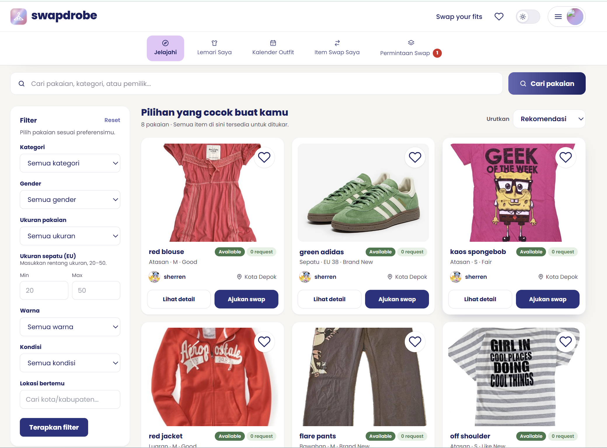
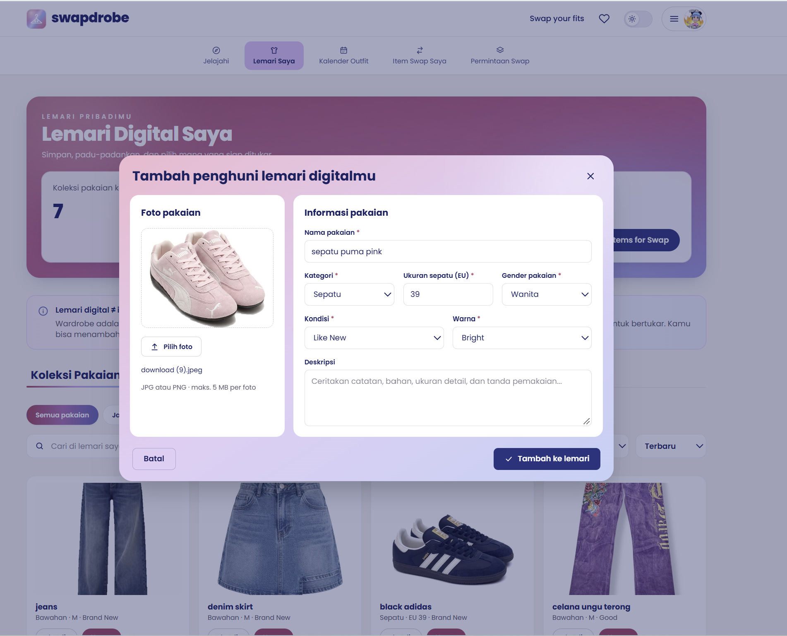
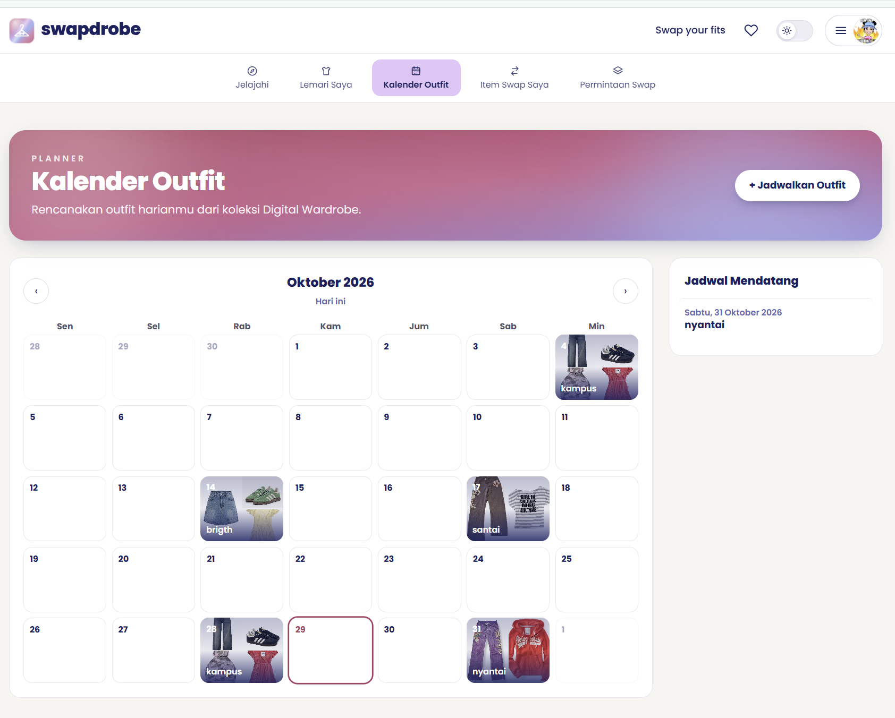
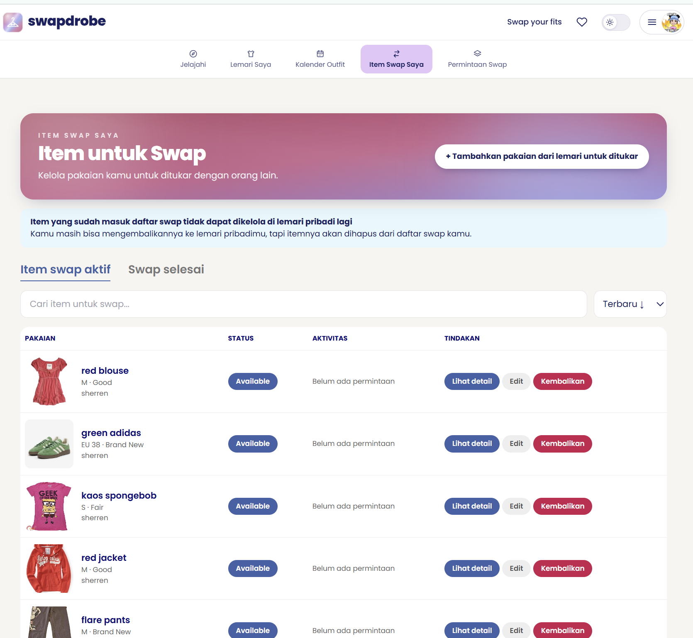
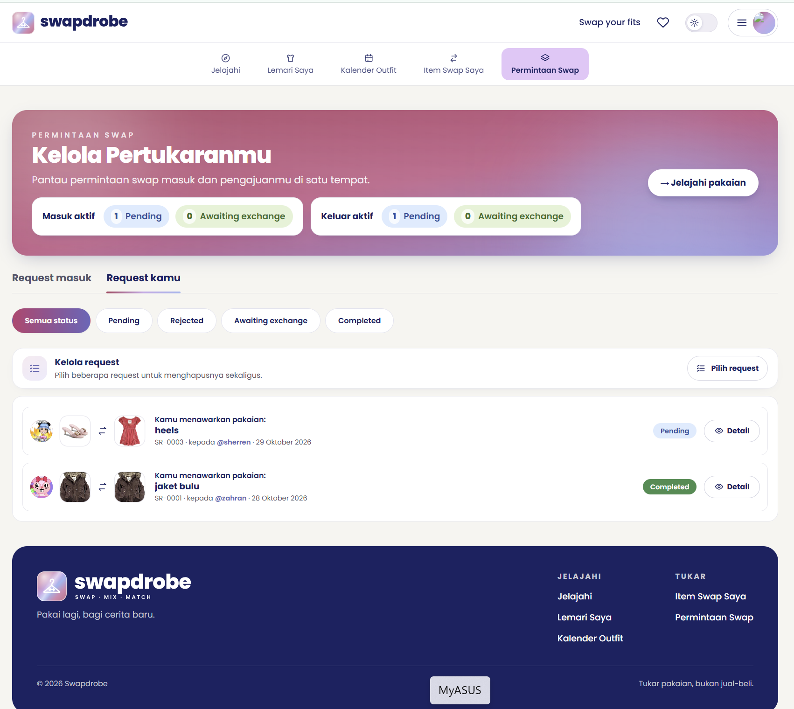
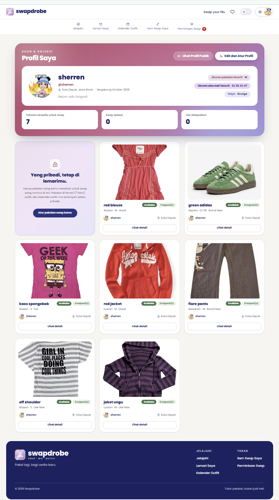

KELOMPOK C12 PBP
# PROYEK-TENGAH-SEMESTER-PBP
# SwapDrobe

> **"Swap what you have, keep it in the loop"**

SwapDrobe adalah aplikasi web yang membantu pengguna mengelola *wardrobe* digital, memadukan dan menjadwalkan *outfit* sehari-hari, serta melakukan *swap*/barter pakaian bekas layak pakai dengan pengguna lain melalui *swap request*.

Aplikasi ini ditujukan bagi pengguna yang ingin lebih mudah mengatur dan memaksimalkan pakaian yang dimiliki, sekaligus mengatasi masalah pakaian yang menumpuk, jarang digunakan, dan kebiasaan membeli pakaian baru. Melalui fitur *digital wardrobe*, *outfit calendar*, *items for swap*, dan *swap request*, pengguna dapat melacak penggunaan pakaian, menyusun kombinasi *outfit*, serta menukar pakaian yang sudah jarang digunakan dengan pakaian milik pengguna lain. Dengan demikian, SwapDrobe mendorong penggunaan pakaian yang lebih optimal dan berkelanjutan sekaligus membantu mengurangi pembelian pakaian baru dan limbah tekstil.

---

## 🔗 Tautan Penting

* **Deployment PWS**: [https://stephanie-revalina-swapdrobe.pws.cs.ui.ac.id/](https://stephanie-revalina-swapdrobe.pws.cs.ui.ac.id/)
* **Desain Figma**: [Figma Low-Fi Design SwapDrobe](https://www.figma.com/design/EC91kdm0tnJODFQhxwIQul/Prototype-Web-PBP?node-id=0-1&p=f&t=eQtZICktQfXXkBwX-0)

---

## 👥 Tim & Anggota (Kelompok C12)

* **Stephanie Revalina Tamus** - 2506547153
* **Muhammad Zahran Affan** - 2506586103
* **Iqbal Virdiansyah** - 2506656816
* **Nafisa Naila Andian** - 2506657125
* **Sultoni Rico Sabillilah** - 2506657365

---

## ⚖️ Perbandingan dengan Aplikasi Serupa

| Aplikasi | Deskripsi Perbandingan |
| :--- | :--- |
| **Whering App** | Whering berfokus pada *digital wardrobe* dan *styling* (mengelola pakaian, membuat kombinasi *outfit*, dan merencanakan pemakaian pakaian). Berbeda dengan Whering, SwapDrobe menambahkan sistem *swap*/barter yang memungkinkan pengguna menukar pakaian yang sudah jarang digunakan dengan pakaian milik pengguna lain melalui *swap request*. |
| **Depop** | Depop merupakan platform jual-beli pakaian bekas yang menggunakan sistem transaksi seperti *marketplace*. Sementara itu, SwapDrobe tidak berfokus pada jual-beli, melainkan pada pertukaran pakaian antar pengguna. Selain itu, SwapDrobe juga menyediakan *digital wardrobe* dan *outfit management*, sehingga pengguna dapat mengelola dan memantau pakaian mereka sebelum memutuskan untuk melakukan *swap*. |

---

## 🧩 Modul Aplikasi & Penanggung Jawab (PIC)

1. **Manajemen Akun & Autentikasi** *(PIC: Iqbal Virdiansyah)* — app `accounts`
   Registrasi (username, password, nomor HP, domisili), login/logout, profil & edit profil, ganti password, hapus akun, profil publik, serta preferensi gaya dan ukuran.
2. **Wardrobe Digital** *(PIC: Stephanie Revalina Tamus)* — app `digital_wardrobe`, beserta halaman Jelajahi & onboarding (app `home`)
   Mengelola koleksi pakaian pribadi dan koleksi *outfit* (kombinasi 1–5 pakaian dari lemari sendiri).
3. **Outfit Calendar** *(PIC: Nafisa Naila Andian)* — app `outfit_calendar`
   Menjadwalkan *outfit* pada tanggal tertentu, menampilkan jadwal dalam kalender, dan mencatat riwayat pemakaian pakaian.
4. **Items for Swap** *(PIC: Sultoni Rico Sabillilah)* — app `items_for_swap`
   Menawarkan pakaian dari lemari untuk ditukar, lengkap dengan lokasi bertemu, sehingga dapat ditemukan pengguna lain.
5. **Swap Request** *(PIC: Muhammad Zahran Affan)* — app `swap_requests`
   Mengajukan, menjawab, dan menyelesaikan permintaan tukar pakaian beserta notifikasi perubahan status.

---

## Deskripsi Modul & Operasi CRUD

| Nama Modul | Peran Pengguna | C (Create) | R (Read) | U (Update) | D (Delete) |
| :--- | :--- | :--- | :--- | :--- | :--- |
| **Manajemen Akun & Autentikasi** | **Admin** | Membuat akun lewat Django Admin | Melihat daftar dan detail profil pengguna lewat Django Admin | Mengubah data profil pengguna | Menghapus akun pengguna |
| | **User** | Membuat akun melalui registrasi | Melihat profil sendiri & profil publik pengguna lain | Mengubah profil, preferensi, dan password | Menghapus akun sendiri |
| **Wardrobe Digital** | **User** | Menambahkan pakaian (dengan foto) & membuat *outfit* | Melihat daftar (cari, filter, urutkan) dan detail pakaian/*outfit* | Mengubah informasi pakaian & susunan *outfit* | Menghapus pakaian (satu atau banyak sekaligus) & *outfit* |
| **Outfit Calendar** | **User** | Menjadwalkan *outfit* pada tanggal tertentu | Melihat jadwal di kalender & detail jadwal | Mengubah tanggal, *outfit*, atau catatan jadwal | Menghapus jadwal |
| **Items for Swap** | **User** | Menawarkan pakaian dari lemari untuk di-*swap* | Melihat item swap sendiri & milik pengguna lain (Jelajahi) | Mengubah lokasi bertemu & deskripsi | Mengembalikan pakaian ke lemari |
| **Swap Request** | **User** | Mengajukan *swap request* dengan menawarkan pakaian sendiri | Melihat *request* yang dikirim & diterima | Mengubah *request*, menerima/menolak, konfirmasi selesai/batal | Menghapus *request* (satu atau banyak) |

---

## Atribut Data Modul

| Nama Modul | Entitas | Input User (Wajib) | Input User (Opsional) | Otomatis Sistem |
| :--- | :--- | :--- | :--- | :--- |
| **Manajemen Akun** | `UserProfile` (1–1 dengan `User`) | `username`, `password`, `phone_number`, domisili (kab/kota dari API Wilayah) | `display_name`, `profile_picture`, `bio`, `preferred_styles`, `preferred_clothing_sizes`, `preferred_shoe_sizes` | `domicile_code`, `domicile_city`, `domicile_province`, `onboarding_completed` |
| **Wardrobe Digital** | `ClothingItem` | `image`, `name`, `category` (Atasan, Bawahan, Luaran, Dress, Sepatu, Aksesori), `size` (XS–XXL / Satu ukuran) **atau** `shoe_size` (EU 20–50, untuk sepatu), `gender`, `condition`, `color` (Netral, Earth, Bright, Pastel) | `description` | `user`, `created_at`, `updated_at`, `last_worn_date` (dari Outfit Calendar), `is_idle` (tidak dipakai > 90 hari), `is_listed_for_swap`, `deleted_at` (*soft-delete*) |
| | `Outfit` | `name`, `items` (1–5 pakaian dari lemari sendiri) | `description` | `user`, `created_at`, `updated_at` |
| **Outfit Calendar** | `OutfitSchedule` (+ `ScheduledItem`) | `date`, `outfit` | `note` | `user`, `outfit_name`, salinan nama pakaian yang dipakai (`ScheduledItem`) |
| **Items for Swap** | `ItemForSwap` | `clothing_item`, kab/kota bertemu, detail tempat bertemu, deskripsi (`reason`) | – | `user`, `meeting_city_code`, `meeting_city`, `meeting_province`, `meeting_location`, `status` (Available / Swapped), `posted_at` |
| **Swap Request** | `SwapRequest` | `offered_item` (pakaian yang ditawarkan) | `message` | `requester`, `owner`, `requested_item`, nama pakaian, `status` (Pending, Rejected, Awaiting exchange, Completed), konfirmasi kedua pihak, waktu dibuat/dijawab/selesai |
| **Jelajahi** | `LikedSwapItem` | – (klik tombol suka) | – | `user`, `listing`, `created_at` |

---

## Daftar Fitur Aplikasi

| Nama Fitur | Deskripsi & Hal yang Ditampilkan | Asal View Modul |
| :--- | :--- | :--- |
| **Jelajahi (Home)** | Katalog *Items for Swap* milik pengguna lain dengan pencarian dan filter (kategori, gender, ukuran, rentang ukuran sepatu, warna, kondisi, lokasi kab/kota) serta urutan (rekomendasi, terbaru, terlama, kondisi). | Home, Items for Swap |
| **Disukai** | Daftar *Items for Swap* yang disukai (tombol hati). | Home, Items for Swap |
| **Onboarding** | Langkah awal setelah registrasi: perkenalan, set up profil, dan preferensi ukuran. | Home, Manajemen Akun |
| **Profil & Profil Publik** | Profil sendiri (edit profil, keamanan akun) dan profil publik pengguna lain beserta item swap-nya. | Manajemen Akun, Items for Swap |
| **Lemari Saya** | Koleksi pakaian & *outfit* pribadi: tambah/edit lewat pop-up, cari & filter tanpa reload, tanda "Jarang dipakai", hapus banyak sekaligus. | Wardrobe Digital |
| **Kalender Outfit** | Jadwal *outfit* dalam tampilan kalender beserta jadwal mendatang. | Outfit Calendar |
| **Item Swap Saya** | Daftar pakaian yang sedang ditawarkan; bisa diedit atau dikembalikan ke lemari. | Items for Swap |
| **Permintaan Swap** | Daftar *request* yang dikirim & diterima, detail, terima/tolak, konfirmasi pertukaran, dan notifikasi perubahan status. | Swap Request |
| **Tema Pink** | Tombol di header untuk mengganti tema tampilan (tersimpan di browser). | Base template |

---

## 🌐 Public API

* **[API Wilayah Indonesia (emsifa.com)](https://www.emsifa.com/api-wilayah-indonesia/v2/provinces.json)**
   Dipakai untuk memilih **kabupaten/kota** (format "Kota, Provinsi") lewat *autocomplete* pada Register & Edit Profil (domisili), Tambah/Edit Items for Swap (kota bertemu), dan filter lokasi di Jelajahi.
   * Data diambil oleh server Django (endpoint `/lokasi/`, `home/wilayah.py`), lalu disimpan di **cache server** selama 24 jam dan **cadangan** selama 30 hari.
   * **Mitigasi saat API bermasalah**: kalau API mati, server memakai data cadangan; kalau hanya sebagian provinsi berhasil dimuat, data tidak dianggap lengkap; pengguna mendapat pop-up peringatan.
   * Pilihan lokasi divalidasi ulang di server, jadi teks bebas atau kode yang tidak valid ditolak.

---

## 🗂️ Sumber Data (Dataset)

* **Data pakaian, outfit, jadwal, item swap, dan swap request** berasal dari input pengguna sendiri di aplikasi (*user-generated*). Kami tidak memakai dataset pakaian eksternal.
* **Foto pakaian & foto profil** diunggah pengguna; di PWS disimpan di Cloudinary, di lokal di folder `media/`.
* **Data wilayah (provinsi & kabupaten/kota)** berasal dari [API Wilayah Indonesia – EmSifa](https://github.com/emsifa/api-wilayah-indonesia).
* **Pilihan kategori, ukuran, warna, kondisi, gender, dan gaya** didefinisikan sendiri di model (`CATEGORY_CHOICES`, `SIZE_CHOICES`, `STYLE_CHOICES`, dll.).

---

## 📸 Tangkapan Layar

| Jelajahi | Lemari Saya |
| :---: | :---: |
|  |  |
| **Tambah pakaian (pop-up)** | **Kalender Outfit** |
|  |  |
| **Item Swap Saya** | **Permintaan Swap** |
|  |  |
| **Profil** | **Tampilan HP & Tema Pink** |
|  |  |

**Demo interaksi tanpa reload (HTMX + optimistic UI)**


---

## 👤 Role Pengguna & Target User

### **Role User**
* **User**: Dapat mengelola profil akun dan *wardrobe* digital, menyusun dan menjadwalkan *outfit* melalui *Outfit Calendar*, menawarkan pakaian melalui *Items for Swap*, mengajukan *Swap Request* kepada pengguna lain, serta menyukai item swap di Jelajahi.
* **Admin**: Mengelola seluruh data (akun, pakaian, *outfit*, jadwal, item swap, *swap request*) melalui Django Admin (`/admin/`).

### **Target User**
Orang-orang yang sering mengelola *fashion* mereka dan ingin memaksimalkan pakaian yang dimiliki.

---

## 🛠️ Tech Stack

| Bagian | Teknologi |
| :--- | :--- |
| Backend | Python, Django 5.2, Gunicorn |
| Database | SQLite (lokal), PostgreSQL (PWS) |
| Frontend | Django Template, CSS per modul (tanpa framework CSS), JavaScript (ES module), HTMX 2 (disimpan lokal di `static/`) |
| File statis & foto | WhiteNoise (static), Pillow (validasi gambar), Cloudinary (penyimpanan foto di PWS) |
| Data eksternal | API Wilayah Indonesia (EmSifa) |
| Testing | Django `TestCase`, coverage, Selenium (functional test) |
| CI/CD | GitHub Actions → PWS |

---

## 💻 Menjalankan Proyek di Lokal

```bash
git clone https://github.com/pbp-kelompok-c12-26/PROYEK-TENGAH-SEMESTER-PBP.git
cd PROYEK-TENGAH-SEMESTER-PBP

python -m venv env
# Windows: env\Scripts\activate   |   macOS/Linux: source env/bin/activate

pip install -r requirements.txt
python manage.py migrate
python manage.py createsuperuser   # opsional, untuk Django Admin
python manage.py runserver
```

Buka `http://127.0.0.1:8000/`. Secara default proyek memakai SQLite dan menyimpan foto di folder `media/`, jadi tidak perlu environment variable apa pun untuk mencoba di lokal.

### Environment Variable

Simpan di file `.env` (lokal) atau di pengaturan environment PWS. **Jangan pernah meng-commit nilai rahasia** (password database, `CLOUDINARY_URL`).

| Nama | Dipakai untuk | Wajib di |
| :--- | :--- | :--- |
| `PRODUCTION` | `True` = mode production (PostgreSQL, Cloudinary) | PWS |
| `DB_NAME`, `DB_USER`, `DB_PASSWORD`, `DB_HOST`, `DB_PORT`, `SCHEMA` | Koneksi PostgreSQL | PWS |
| `CLOUDINARY_URL` | Kredensial Cloudinary (`cloudinary://<api_key>:<api_secret>@<cloud_name>`) untuk menyimpan foto | PWS |
| `CLOUDINARY_FOLDER` | Folder foto di Cloudinary (default `swapdrobe`) | Opsional |
| `WILAYAH_API_URL` | Alamat API Wilayah Indonesia (default EmSifa v2) | Opsional |
| `CACHE_DIR` | Folder cache server (default folder temp sistem) | Opsional |

---

## 🧪 Testing

```bash
pip install -r requirements-dev.txt     # coverage & selenium (hanya untuk development)

python manage.py test                   # seluruh test proyek

# coverage, contoh untuk modul Digital Wardrobe
coverage run --source=digital_wardrobe manage.py test digital_wardrobe
coverage report --omit="*/migrations/*,*/tests*.py"
```

* **Unit test** ada di `tests.py` setiap app. API Wilayah dan Cloudinary disimulasikan, jadi test berjalan tanpa internet.
* **Functional test (Selenium)** ada di `digital_wardrobe/tests_functional.py` dan membutuhkan Google Chrome. Test ini otomatis dilewati kalau Selenium/Chrome tidak tersedia. Tambahkan `SELENIUM_HEADLESS=0` untuk melihat jendela Chrome saat test berjalan.

---

## 🚀 Deployment & Alur Kerja Git

* **Alur branch**: setiap fitur dikerjakan di branch sendiri → *pull request* ke `dev` → setelah stabil, *pull request* `dev` ke `main`.
* **Proteksi `main`** (GitHub Ruleset): wajib lewat *pull request* dengan minimal **1 approval** dari anggota lain, dan *force push* diblokir.
* **Format commit** (*conventional commits*): `feat:`, `fix:`, `style:`, `refactor:`, `test:`, `docs:`, mis. `feat(wardrobe): hapus banyak pakaian sekaligus`.
* **CI/CD**: setiap *push* ke `main` menjalankan GitHub Actions (`.github/workflows/deploy.yml`) yang mendorong kode ke PWS, lalu PWS membangun ulang aplikasi.
* **Foto upload**: folder `media/` di server PWS ikut kosong setiap kali aplikasi dibangun ulang, sehingga di production foto disimpan di **Cloudinary** (`PROJECTS/storage.py`). Di lokal dan saat test, foto tetap disimpan di folder `media/`.

---

## ✨ Fitur Teknis per Modul

### Wardrobe Digital *(Stephanie)*
* **CRUD lengkap** pakaian & *outfit* dengan validasi ketat (foto JPG/PNG maks. 5 MB yang dicek Pillow, ukuran baju vs ukuran sepatu, *outfit* 1–5 pakaian milik sendiri).
* **Soft-delete**: pakaian yang sudah dipakai di *outfit*/kalender/riwayat swap hanya diarsipkan, sehingga riwayatnya tetap utuh.
* **Hapus banyak sekaligus** (mode "Pilih") dalam satu transaksi dengan jumlah query tetap (tidak N+1).
* **HTMX tanpa reload**: cari, filter, urutkan, muat lebih banyak, pindah tab, dan hapus; URL ikut berubah sehingga tombol Back tetap berfungsi.
* **Optimistic UI**: kartu langsung memudar saat dihapus dan dikembalikan bila server menolak.
* **JavaScript modular** (ES module) di `static/digital_wardrobe/js/`.
* **Keamanan** (`digital_wardrobe/security.py`): decorator `@owner_required` (data milik orang lain → 403 + dicatat di log), `@rate_limit` (batas permintaan → 429), dan `@wardrobe_login_required` (sesi habis saat AJAX → 401).
* **Testing**: unit test model/form/view/keamanan dengan coverage modul ±99%, ditambah functional test Selenium.

### Manajemen Akun & Autentikasi *(Iqbal)*
* **Registrasi lengkap**: username, password (validator bawaan Django), nomor HP, dan domisili kab/kota dari API Wilayah Indonesia.
* **Validasi nomor HP** di server: format dinormalisasi (`+62`/`62` → `0`), dicek polanya, dan harus unik antarakun.
* **Validasi foto profil**: maks. 5 MB, hanya JPG/PNG, dan isi file diverifikasi dengan Pillow (file palsu ditolak).
* **Onboarding 3 langkah** setelah registrasi (perkenalan, set up profil, preferensi gaya & ukuran) yang bisa dilewati.
* **Edit profil & keamanan akun**: ganti password, hapus akun dalam satu transaksi database, serta profil publik `/accounts/u/<username>/` yang menampilkan item swap pengguna.
* **Preferensi** gaya, ukuran pakaian, dan ukuran sepatu disimpan sebagai `JSONField` (pilihan banyak).

### Outfit Calendar *(Nafisa)*
* **Tampilan kalender bulanan** (navigasi bulan sebelumnya/berikutnya) dengan kolase hingga 4 foto pakaian di setiap tanggal, serta daftar jadwal mendatang.
* **Satu jadwal per tanggal**: tanggal yang sudah terisi ditolak dengan pesan yang jelas.
* **Snapshot pakaian** (`ScheduledItem`): nama pakaian yang dipakai tetap tersimpan walaupun pakaian/outfit kemudian dihapus atau ditukar.
* **`last_worn_date` otomatis** dihitung ulang setiap jadwal dibuat, diubah, atau dihapus, sehingga status "Jarang dipakai" di Lemari Saya selalu akurat.
* Form jadwal tampil sebagai **pop-up tanpa pindah halaman**; menghapus outfit di Lemari ikut menghapus jadwal mendatang namun mempertahankan riwayat.
* **Unit test** untuk model, form, dan view di `outfit_calendar/tests.py`.

### Items for Swap *(Rico)*
* **Menawarkan pakaian dari lemari** dalam transaksi atomik (`select_for_update`), sehingga pakaian yang sama tidak bisa ditawarkan dua kali.
* **Lokasi bertemu terstruktur**: kab/kota dari API Wilayah (divalidasi server) + detail tempat; data lama berbentuk teks bebas tetap tampil.
* **Semua field wajib** dengan pesan error per field di dalam pop-up, ditambah pop-up konfirmasi sebelum publish.
* **Item Swap Saya**: tab aktif/selesai, pencarian, urutan terbaru/terlama, dan tombol **kembalikan ke lemari**.
* **Konsisten dengan modul lain**: listing yang sedang dalam proses tukar dikunci, listing yang dihapus otomatis mengembalikan pakaian ke lemari (signal), dan status berubah menjadi *Swapped* saat pertukaran selesai.

### Swap Request *(Zahran)*
* **Alur status lengkap**: Pending → (Rejected | Awaiting exchange) → Completed/Rejected, dengan konfirmasi "Selesai swap" atau "Batalkan swap" dari **kedua pihak**.
* **Pertukaran atomik**: saat selesai, kedua pakaian berpindah pemilik, listing menjadi *Swapped*, dan request lain yang memakai pakaian tersebut otomatis ditolak.
* **Pencegahan bentrok**: request tidak bisa disetujui jika salah satu pakaian sedang dalam pertukaran lain; pakaian yang sedang di-request tidak bisa diedit atau dihapus dari lemari.
* **Notifikasi perubahan status** dengan badge jumlah belum dibaca di navigasi.
* **Hapus satu atau banyak request** sekaligus (dengan `select_for_update`), dan request disembunyikan per pihak sehingga riwayat pihak lain tetap ada.
* Form ajukan/edit request tampil sebagai **pop-up** dengan pratinjau pakaian yang ditawarkan.

### Jelajahi, Disukai & Integrasi API *(Stephanie & Zahran)*
* **Katalog Jelajahi** dengan pencarian dan filter berlapis (kategori, gender, ukuran, rentang ukuran sepatu dengan validasi, warna, kondisi, lokasi) serta urutan terbaru, terlama, dan kondisi terbaik (diurutkan di database dengan `Case/When`).
* **Tombol suka** tanpa reload (AJAX) dan halaman **Disukai**.
* **Integrasi API Wilayah** (`home/wilayah.py`): endpoint `/lokasi/`, cache server 24 jam + cadangan 30 hari, penanda data tidak lengkap, dan respons 503 saat API mati.
* **Form pop-up bersama** (`static/js/form_modal.js`) dipakai Items for Swap, Outfit Calendar, dan Swap Request; validasi tetap di view Django.

---

## 🤖 AI Disclosure

Dalam pengembangan SwapDrobe, kami menggunakan **ChatGPT, Claude, dan OpenAI Codex di IDE** sebagai alat bantu untuk memahami struktur kode, mendiskusikan pendekatan implementasi, dan menyusun perubahan awal. AI membantu mempercepat eksplorasi dan memberi penjelasan saat kami mengerjakan integrasi antarmodul, tampilan, autocomplete lokasi, interaksi tanpa reload (HTMX), keamanan, pengujian, serta penyimpanan foto di Cloudinary. Keputusan desain dan kode akhir tetap kami tinjau sebagai tim.

Contoh prompt yang kami gunakan:

* “Telusuri model, form, view, URL, dan template yang sudah ada sebelum mengubah fitur ini. Gunakan struktur yang tersedia dan batasi perubahan pada kebutuhan terkait.”
* “Buat autocomplete kabupaten/kota menggunakan API Wilayah Indonesia EmSifa, termasuk validasi pilihan di server, penanganan data yang gagal dimuat, dan tampilan yang konsisten dengan website.”
* “Jelaskan alur dan potensi masalah pada kode ini tanpa mengubahnya, supaya kami memahami hubungan antarbagian sebelum menentukan perbaikan.”
* “Kenapa foto upload hilang di PWS setelah deploy, dan apa saja pilihan solusinya beserta risikonya?”

Strategi kami adalah menggunakan AI untuk membantu memetakan masalah dan membuat usulan yang bisa ditinjau, bukan menerima hasilnya begitu saja. Kami mencocokkan usulan tersebut dengan model, form, view, URL, template, serta aturan bisnis yang sudah ada. Untuk informasi API dan layanan pihak ketiga, kami memeriksa dokumentasi resminya (EmSifa, Cloudinary); untuk perubahan kode, kami meninjau alur input sampai data tersimpan dan tampilan digunakan.

Setelah menggunakan AI, kami melakukan pemeriksaan dan penyesuaian manual. Pada autocomplete lokasi, misalnya, kami memastikan pengguna harus memilih rekomendasi yang valid, pilihan diverifikasi kembali oleh server, dan kegagalan sebagian endpoint tidak dianggap sebagai data lengkap. Kami juga menyesuaikan field dan styling agar mengikuti pola proyek, meninjau migrasi terhadap kondisi database yang sudah berjalan, serta menjalankan pemeriksaan Django dan tes yang relevan. Proses ini membantu kami memahami alasan di balik implementasi sekaligus menemukan dan memperbaiki ketidaksesuaian sebelum perubahan digunakan.

### Keterbatasan AI yang Kami Temui & Perbaikan Manual

Berikut contoh nyata saat hasil AI ternyata salah, kurang lengkap, atau tidak sesuai kondisi proyek, beserta cara kami menemukan dan memperbaikinya:

| Masalah dari saran AI | Cara kami menemukannya | Perbaikan manual |
| :--- | :--- | :--- |
| AI menyarankan alamat host PWS yang salah untuk secret `PWS_URL` di GitHub Actions, sehingga deploy gagal. | Log GitHub Actions gagal (exit code 128). | Mencocokkan dengan alamat di dashboard PWS, lalu memperbaiki secret. |
| Saat field Items for Swap dijadikan wajib, validasi JavaScript lokasi menahan form yang kosong sehingga pesan error field lain tidak muncul. | Diuji manual di browser dengan mengirim form kosong. | Lokasi kosong dibiarkan dicek server agar semua pesan error tampil bersamaan; pesan "pilih dari daftar" tetap muncul di sisi klien. |
| Kode HTMX awal menyimpan referensi elemen saat halaman dimuat; setelah tombol *Back*, pop-up hapus tidak bisa dibuka lagi. | Pengujian otomatis di browser gagal saat menekan tombol *Back*. | Elemen dicari ulang setiap kali dipakai dan keadaan sementara dibersihkan sebelum HTMX menyimpan riwayat. |
| Penghapusan banyak pakaian awalnya memuat ulang halaman dan pesan suksesnya hilang. | Pengujian manual di browser. | Daftar diambil ulang lewat HTMX tanpa reload, pesan tetap tampil. |
| AI mula-mula menduga foto hilang di PWS karena bug kode. | Membuka URL foto langsung: file dari git tampil, file upload-an 404 (`/app/media/... does not exist`). | Penyebab sebenarnya adalah folder `media/` yang kosong setiap deploy; solusinya penyimpanan Cloudinary. |
| Paket `django-cloudinary-storage` yang umum disarankan sudah lama tidak diperbarui dan belum jelas mendukung `STORAGES` di Django 5.2. | Memeriksa dokumentasi & versi paket. | Memakai SDK resmi `cloudinary` dengan kelas storage sendiri yang diuji (`home/tests_storage.py`). |

**Pelajaran yang kami ambil**
* AI tidak tahu kondisi lingkungan kami yang sebenarnya (PWS, isi secret, data di server), sehingga hipotesisnya harus dibuktikan dengan log, URL, atau test.
* AI bisa yakin tetapi keliru (mis. nama host); kami selalu mencocokkan dengan sumber resmi.
* Kode dari AI tidak kami anggap selesai sebelum lolos test otomatis dan pengujian manual di browser (desktop & HP).
* Kami tidak pernah memberikan data rahasia (password database, `CLOUDINARY_URL`, secret GitHub) kepada AI.
